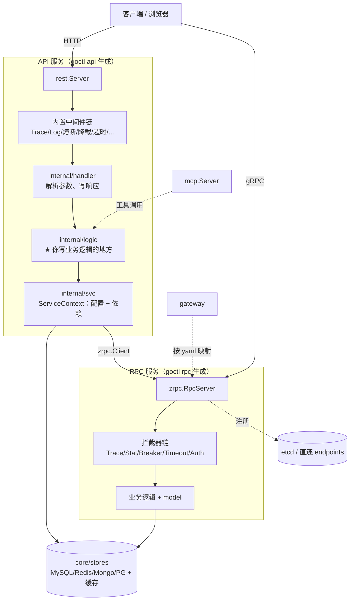
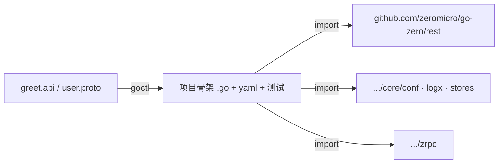

# go-zero 入门指南（基于本仓库源码）

> 面向第一次接触 go-zero 的 Go 开发者。
> 本文不是官网文档的搬运，而是对照当前工作区 `D:/GoWork/src/go-zero` 的源码整理的"读代码地图"。
> 仓库信息：`module github.com/zeromicro/go-zero`，`go 1.25.0`（`go.mod`）。整理日期：2026-11-10。

---

## 0. 一句话先建立心智模型

**go-zero = 一套运行时框架（库）+ 一个代码生成工具 `goctl`（脚手架）。**

它最特别的地方不是"又一个 Gin"，而是**工具驱动**：

```
你写 .api / .proto（描述接口，不是写 Go 代码）
        ↓ goctl 生成
整个可运行的服务骨架（路由、参数解析、DTO、配置、逻辑层、测试文件）
        ↓ 你只填
logic 包里的业务代码
```

所以学习 go-zero 的正确顺序是：**先学会用 goctl 生成项目 → 再读懂生成的代码 → 最后才去看框架内部怎么保护服务**。千万别一上来扎进 `core/` 的四百多个文件里。

官网设计准则（`readme-cn.md`）：保持简单、高可用、弹性设计（面向故障编程）、工具大于约定和文档、业务友好。

---

## 1. 仓库地图：每个目录是干什么的

| 目录 | 定位 | 你要不要读 |
| --- | --- | --- |
| `tools/goctl/` | **代码生成器**，独立 Go module（`tools/goctl/go.mod`），本身是个 CLI | 先会用，再看实现 |
| `rest/` | HTTP 服务端：路由、参数解析、中间件、JWT、CORS | 必读（只看 `server.go` / `engine.go` / `config.go`） |
| `zrpc/` | gRPC 服务端与客户端封装：服务发现、负载均衡、拦截器 | 做微服务时读 |
| `core/` | 通用基础库（44 个子包）：日志、熔断、限流、降载、缓存、ORM、并发工具 | 按需查，当工具箱用 |
| `gateway/` | 纯配置式的 gRPC → HTTP 网关，不用写转换代码 | 有需要再看 |
| `mcp/` | 基于官方 MCP Go SDK 的封装，把 go-zero 服务暴露成 MCP Server | 做 AI 工具接入时看 |
| `internal/` | 框架内部实现（devserver、health、trace 等），外部不能 import | 不用读 |

**关键认知**：`rest` 和 `zrpc` 是"服务端骨架"，`core` 是"零件库"，`goctl` 是"装配机器"，三者互相独立又配套使用。

---

## 2. 整体架构



生成工具与运行时源码的关系：



---

## 3. 五分钟跑起来

### 3.1 安装 goctl

```bash
# 注意路径必须带 /tools/goctl，它是独立的 module
go install github.com/zeromicro/go-zero/tools/goctl@latest
goctl --version
```

### 3.2 两条最省事的路

**方式 A：一键示例（最快）**

```bash
mkdir demo && cd demo
goctl quickstart                 # 默认 -t mono（单体）
# goctl quickstart -t micro     # 微服务版（API + RPC）
```

它会**在当前目录创建 `greet/` 项目**并自动 `go mod tidy` + `go run .`（见 `tools/goctl/quickstart/quickstart.go`、`run.go`）。

> ⚠️ 坑：如果当前目录已有 `greet/`，它会询问是否清理并**删除整个目录**（`os.RemoveAll`）。别在有内容的目录里随手跑。

**方式 B：生成一个正式项目（推荐从这里开始）**

```bash
goctl api new greet
cd greet
go mod tidy
go run greet.go -f etc/greet-api.yaml
curl -i http://localhost:8888/from/you
```

`greet.api` 的默认内容来自 `tools/goctl/api/new/api.tpl`：

```go
type Request {
  Name string `path:"name,options=you|me"`
}
service greet-api {
  @handler GreetHandler
  get /from/:name(Request) returns (Response)
}
```

### 3.3 生成出来的目录长什么样

目录常量定义在 `tools/goctl/api/gogen/vars.go`，标准结构：

```
greet/
├── greet.go                        # main：加载配置 → 建 server → 注册路由 → Start
├── go.mod
├── etc/
│   └── greet-api.yaml              # 配置（模板只有 Name / Host / Port 三行）
└── internal/
    ├── config/config.go            # type Config struct { rest.RestConf }
    ├── handler/                    # HTTP 层：httpx.Parse → logic → httpx.OkJsonCtx
    │   ├── routes.go               # ⛔ DO NOT EDIT，重新生成会覆盖
    │   └── xxxhandler.go           # ✅ Safe to edit
    ├── logic/                      # ★ 业务代码，模板里留了 todo
    ├── svc/servicecontext.go       # 依赖容器
    ├── types/types.go              # .api 里的 type 生成的 DTO
    └── middleware/                 # 声明了 middleware 时才生成
```

---

## 4. `.api` 文件：go-zero 的接口 DSL

完整语法示例取自 `tools/goctl/api/gogen/testdata/example.api`，精简后：

```go
syntax = "v1"

info(
    title: "demo title"
    author: "keson.an"
    version: "v1"
)

type LoginReq {
    Username string `json:"username"`
    Password string `json:"password"`
}

type PathExampleReq {
    ID string `path:"id"`
}

type LoginResp {
    Name string `json:"name"`
}

@server(
    jwt: Auth            // 该组路由启用 JWT
    prefix: /v1          // 路由前缀
    group: g1            // 代码分组
    timeout: 3s          // 该组超时
    middleware: AuthInterceptor
    maxBytes: 1048576
)
service demo-api {
    @handler login
    post /login (LoginReq) returns (LoginResp)

    @handler pathExample
    get /path/example/:id (PathExampleReq) returns (PathExampleResp)
}
```

**几条规则记住就够：**

| 元素 | 作用 |
| --- | --- |
| `syntax = "v1"` | 固定写第一行 |
| `type Xxx { ... }` | 定义请求/响应 DTO，生成到 `internal/types/types.go` |
| struct tag | `json` 请求体、`path` 路径参数、`form` 表单；`options=a\|b` 可做枚举校验 |
| `@server(...)` | 对下面整组 service 生效：`jwt` / `prefix` / `group` / `middleware` / `timeout` / `maxBytes` |
| `service xxx { ... }` | 服务名决定生成的目录名 |
| `@handler xxx` | 一个 handler = 一个 Go 文件，方法 + 路径 + 可选 `(Req)` + 可选 `returns (Resp)` |

生成命令：

```bash
goctl api go -api greet.api -dir . --style go_zero
# 常用附带参数：--test（生成测试）、--type-group（类型分组）
```

同一份 `.api` 还能生成别的东西：`goctl api ts / dart / kt / doc / swagger / validate / format / plugin`（命令注册见 `tools/goctl/api/cmd.go`）——这就是官网说的"一份定义、多端代码"。

---

## 5. 一个请求到底怎么走（重点）

以 `POST /login` 为例，逐层对照源码：

| 步骤 | 文件 | 做了什么 |
| --- | --- | --- |
| 1 | `greet.go` | `conf.MustLoad(*configFile, &c)` → `rest.MustNewServer(c.RestConf)` → `svc.NewServiceContext(c)` → `handler.RegisterHandlers(server, ctx)` → `server.Start()` |
| 2 | `rest/server.go` | `NewServer` 里 `c.SetUp()`（初始化日志/链路追踪/Prometheus/优雅退出）、`newEngine(c)`、`router.NewRouter()` |
| 3 | `rest/engine.go` | `bindRoute` 把 **中间件链 + handler** 绑到路由上 |
| 4 | `internal/handler/routes.go` | `server.AddRoutes([]rest.Route{{Method, Path, Handler}})`，带 `WithJwt` / `WithPrefix` / `WithTimeout` 等 RouteOption |
| 5 | `internal/handler/xxxhandler.go` | `httpx.Parse(r, &req)` 解析并校验参数 → 调 logic → `httpx.OkJsonCtx` / `httpx.ErrorCtx` |
| 6 | `internal/logic/xxxlogic.go` | **你写的业务代码**，`svcCtx` 里拿配置、DB、RPC client |
| 7 | `internal/svc/servicecontext.go` | 依赖容器（配置 + 中间件 + 各种 client），相当于轻量 DI |

生成的 `main`（`tools/goctl/api/gogen/main.tpl`，原样）：

```go
var configFile = flag.String("f", "etc/greet.yaml", "the config file")

func main() {
    flag.Parse()
    var c config.Config
    conf.MustLoad(*configFile, &c)
    server := rest.MustNewServer(c.RestConf)
    defer server.Stop()
    ctx := svc.NewServiceContext(c)
    handler.RegisterHandlers(server, ctx)
    fmt.Printf("Starting server at %s:%d...\n", c.Host, c.Port)
    server.Start()
}
```

生成的 handler（`handler.tpl`）：

```go
func XxxHandler(svcCtx *svc.ServiceContext) http.HandlerFunc {
    return func(w http.ResponseWriter, r *http.Request) {
        var req types.XxxReq
        if err := httpx.Parse(r, &req); err != nil {
            httpx.ErrorCtx(r.Context(), w, err)
            return
        }
        l := logic.NewXxxLogic(r.Context(), svcCtx)
        resp, err := l.Xxx(&req)
        if err != nil {
            httpx.ErrorCtx(r.Context(), w, err)
        } else {
            httpx.OkJsonCtx(r.Context(), w, resp)
        }
    }
}
```

生成的 logic（`logic.tpl`）——**你唯一需要长期改的层**：

```go
type XxxLogic struct {
    logx.Logger
    ctx    context.Context
    svcCtx *svc.ServiceContext
}

func (l *XxxLogic) Xxx(req *types.XxxReq) (*types.XxxResp, error) {
    // todo: add your logic here and delete this line
    return &types.XxxResp{}, nil
}
```

> 框架把"参数解析、错误响应、日志、超时、熔断"全包了，业务层只负责"输入 → 输出 / error"。这是 go-zero 最核心的开发体验。

**文件头注释要看**：`routes.go` 是 `Code generated by goctl. DO NOT EDIT.`；handler/logic/svc 是 `Code scaffolded by goctl. Safe to edit.`。改错了地方，下次重新生成就没了。

---

## 6. 配置怎么加载

加载器在 `core/conf`，用法见 `core/conf/readme.md`：

```go
conf.MustLoad(*configFile, &c)                 // 出错直接退出
conf.Load(file, &c, conf.UseEnv())             // 支持环境变量
```

支持 **yaml / toml / json**，靠结构体 tag 做校验和默认值：

| tag 写法 | 含义 |
| --- | --- |
| `json:",default=0.0.0.0"` | 缺省值 |
| `json:",optional"` | 允许不填 |
| `json:",options=dev\|test\|pro"` / `options=[file,console]` | 枚举校验 |
| `json:",range=[0:1000)"` | 范围校验 |
| `json:",env=SERVICE_NAME"` | 从环境变量取值 |
| `yaml` 里 `${MAX_BYTES}` | 引用环境变量 |

`rest.RestConf`（`rest/config.go`）关键字段：

| 字段 | 默认 | 说明 |
| --- | --- | --- |
| `Host` / `Port` | `0.0.0.0` / 必填 | 监听地址 |
| `Timeout` | `3000`（**毫秒**） | 全局超时，同时决定 `http.Server` 的 Read/WriteTimeout |
| `MaxConns` | `10000` | 最大并发连接 |
| `MaxBytes` | `1048576` | 请求体上限（1MB） |
| `CpuThreshold` | `900` | **千分比**，900 = CPU 90% 触发自适应降载 |
| `Middlewares` | 全 true | 中间件开关 |
| `Signature` | 可选 | 接口签名校验 |

`ServiceConf`（`core/service/serviceconf.go`）是所有服务共用的：`Name`、`Log`、`Mode`、`MetricsUrl`、`Telemetry`（OpenTelemetry）、`DevServer`、`Shutdown`、`Profiling`。

```yaml
Name: greet-api
Host: 0.0.0.0
Port: 8888
Mode: pro                 # dev|test|rt|pre|pro
Timeout: 3000
MaxConns: 10000
MaxBytes: 1048576
CpuThreshold: 900
Log:
  ServiceName: greet-api
  Level: info
Middlewares:
  Trace: true
  Log: true
  Prometheus: true
  MaxConns: true
  Breaker: true
  Shedding: true
  Timeout: true
  Recover: true
  Metrics: true
  MaxBytes: true
  Gunzip: true
```

> `Mode` 设为 `dev/test/rt/pre` 时，`ServiceConf.SetUp()` 会执行 `load.Disable()` 并关掉统计上报（`serviceconf.go:83`）——**压测和性能验证别用 dev 模式**。

---

## 7. 框架最值钱的部分：内置弹性保护

`rest/engine.go:130` 的 `buildChainWithNativeMiddlewares` 按下面顺序组装中间件链，`rest/chain/chain.go` 确认了"Append 顺序 = 请求流经顺序"：

| # | 中间件 | 作用 | 对应源码 |
| --- | --- | --- | --- |
| 1 | Trace | 链路追踪（OpenTelemetry） | `rest/handler/tracehandler.go` |
| 2 | Log | 访问日志（Verbose 时更详细） | `loghandler.go` |
| 3 | Prometheus | 指标采集 | `prometheushandler.go` |
| 4 | MaxConns | 并发连接数限流 | `maxconnshandler.go` |
| 5 | Breaker | 熔断器，按 method+path 隔离 | `breakerhandler.go` |
| 6 | Shedding | **自适应降载**，CPU 超阈值主动丢请求（无需配置） | `sheddinghandler.go` |
| 7 | Timeout | 超时控制 | `timeouthandler.go` |
| 8 | Recover | panic 恢复 | `recoverhandler.go` |
| 9 | Metrics | 耗时/错误统计 | `metrichandler.go` |
| 10 | MaxBytes | 请求体大小限制 | `maxbyteshandler.go` |
| 11 | Gunzip | gzip 解压 | `gunziphandler.go` |

之后才追加 `WithJwt(secret)` / 签名校验 / `server.Use(...)` 注册的自定义中间件（`engine.go:108-112`）。所有开关默认全开，可在 yaml 的 `Middlewares:` 里逐个关掉。

**这几个能力都是"自动生效"的**，这是 go-zero 相对 Gin + 一堆中间件的最大差异：限流、熔断、降载、超时级联不用你写一行代码。

---

## 8. RPC / 微服务侧

### 8.1 生成与启动

```bash
# 由 proto 生成 zrpc 服务（参数见 tools/goctl/rpc/cmd.go）
goctl rpc protoc user.proto --go_out=. --go-grpc_out=. --zrpc_out=.
# 或直接给模板
goctl rpc new user
```

服务端（`zrpc/server.go`）启动时会：校验配置 → 有 etcd 就注册服务 → 按开关追加拦截器 → `Start(register)`。

### 8.2 拦截器链（`zrpc/server.go:144`）

`Trace → Recover → Stat → Prometheus → Breaker → Shedding(CpuThreshold>0) → Timeout(Timeout>0)`，另外 `Auth: true` 时追加基于 Redis 的鉴权拦截器（`setupAuthInterceptors`）。

### 8.3 配置（`zrpc/config.go`）

```yaml
# 服务端 RpcServerConf
Name: user.rpc
ListenOn: 0.0.0.0:8080
Etcd:
  Hosts: [localhost:2379]
  Key: user.rpc
Timeout: 2000           # 毫秒，0 表示不启用
CpuThreshold: 900
Health: true            # gRPC 健康检查，默认开
Auth: false             # 开 true 必须配 Redis（Validate 会检查）
```

```yaml
# API 服务里调用它：把 zrpc.RpcClientConf 嵌进自己的 Config
UserRpc:
  Etcd:
    Hosts: [localhost:2379]
    Key: user.rpc
  Timeout: 2000
  NonBlock: true
  BalancerName: p2c_ewma    # 默认负载均衡算法
```

客户端三种寻址方式（`RpcClientConf.BuildTarget`）：`Endpoints` 直连、`Target` 自定义、或 `Etcd` 服务发现。`HasEtcd()` 决定服务端是否注册到 etcd。相关实现在 `zrpc/resolver/`、`zrpc/internal/balancer/`、`core/discov/`。

> 命名细节：配置类型叫 `RestConf` / `RpcServerConf` 而不是 `Conf`，就是为了让你能在一个 `Config` 里同时嵌套两者（源码注释里写得很清楚）。

---

## 9. `core/` 工具箱速查（不用全学，用到再查）

| 分类 | 包 | 一句话 |
| --- | --- | --- |
| 配置/日志 | `conf` `logx` `logc` `configcenter` | 配置加载、结构化日志、配置中心 |
| 服务治理 | `breaker` `limit` `load` `proc` `stat` `metric` `trace` `prometheus` | 熔断、限流、自适应降载、优雅退出、统计、链路追踪 |
| 数据存储 | `stores/sqlx` `stores/sqlc` `stores/redis` `stores/cache` `stores/mon` `stores/postgres` `stores/kv` `stores/builder` | MySQL/PG/Mongo/Redis、带缓存的 model、SQL 构造 |
| 服务发现 | `discov` `naming` `resolver`(zrpc) | etcd 注册与发现 |
| 并发/集合 | `fx` `mr` `executors` `syncx` `threading` `collection` `queue` | 流式处理、MapReduce、并发池、安全 map、队列 |
| 杂项 | `mapping` `validation` `jsonx` `stringx` `hash` `bloom` `codec` `rescue` | 结构体映射、参数校验、JSON、布隆过滤器、panic 保护 |

**Model 生成**（`tools/goctl/model/cmd.go`）：

```bash
goctl model mysql datasource -url="root:pass@tcp(127.0.0.1:3306)/demo" -table="user" -dir="./model" -c   # -c 带缓存
goctl model mysql ddl -src="./sql/*.sql" -dir="./model"
goctl model pg datasource -url="..." -table="user" -dir="./model"
goctl model mongo -t User -d ./model
```

---

## 10. 两个附加模块

- **`gateway/`**：不用写 controller 的 HTTP→gRPC 网关。配置里写 `Upstreams[].Mappings` 把 `GET /pingHello/:ping` 映射到 `hello.Hello/Ping`，支持 etcd 发现、`ProtoSets` 描述符文件、或 gRPC reflection。示例见 `gateway/readme.md`。
- **`mcp/`**：把服务包装成 MCP Server（基于官方 `modelcontextprotocol/go-sdk`），支持 SSE 与 Streamable HTTP 两种传输，`mcp.AddTool(server, tool, handler)` 用泛型自动从 struct tag 生成 JSON Schema。示例见 `mcp/readme.md`。

---

## 11. goctl 命令速查

命令注册见 `tools/goctl/cmd/root.go` 与各子包 `cmd.go`。

| 命令 | 用途 |
| --- | --- |
| `goctl quickstart [-t mono\|micro]` | 生成并启动示例项目 |
| `goctl api new <name>` | 生成完整 API 服务 |
| `goctl api -o file.api` | 生成 `.api` 模板文件 |
| `goctl api go -api x.api -dir . [--style go_zero] [--test]` | 由 `.api` 生成 Go 代码 |
| `goctl api validate --api x.api` / `format --dir x.api` | 校验 / 格式化 DSL |
| `goctl api doc / swagger / ts / dart / kt / java` | 生成文档与多端 SDK |
| `goctl api plugin -p plugin -api x.api -dir .` | 自定义插件生成 |
| `goctl rpc new / protoc / template` | 生成 zrpc 服务 |
| `goctl model mysql\|pg\|mongo ...` | 由表结构生成 model |
| `goctl docker` `goctl kube` | 生成 Dockerfile / K8s 编排 |
| `goctl tpl` `goctl env` `goctl config` `goctl upgrade` `goctl migrate` `goctl bug` | 模板管理、环境检查、升级、迁移、报 issue |

---

## 12. 新手最容易踩的坑

| # | 坑 | 说明 |
| --- | --- | --- |
| 1 | 改了 `routes.go` | 它是 `DO NOT EDIT`，重新 `goctl api go` 会覆盖。业务写在 logic，路由改 `.api` 再生成 |
| 2 | goctl 安装路径漏了 `/tools/goctl` | 该目录是**独立 module**，装错会报找不到包 |
| 3 | Go 版本 | 本仓库 `go.mod` 要求 `go 1.25.0`，版本低了编译不过 |
| 4 | 超时单位 | REST/RPC 的 `Timeout` 都是**毫秒**（默认 3000 / 2000），`@server timeout: 3s` 是 DSL 里的 duration |
| 5 | 超时级联 | 上游 REST 超时必须 > 下游 RPC 超时，否则上游已返回、下游还在空跑；REST 的 `Timeout: 0` 表示不设，RPC `Timeout: 0` 表示不加超时拦截器 |
| 6 | `CpuThreshold` | 取值 0~1000 的**千分比**，`900` 是 90% CPU，别写成 `90` |
| 7 | `Mode: dev` 压测 | 非 pro 模式会 `load.Disable()` 并关闭统计上报，测出来的结果不可信 |
| 8 | 路由级超时比全局大 | `engine.mightUpdateTimeout` 会把 `http.Server` 的 Read/WriteTimeout 自动抬到所有路由里的最大值（`engine.go:224`） |
| 9 | `Auth: true` 没配 Redis | `RpcServerConf.Validate()` 会校验 Redis 配置并直接返回错误 |
| 10 | `quickstart` 在有 `greet/` 的目录跑 | 会询问是否删除该目录并 `RemoveAll`，别在重要目录执行 |
| 11 | 一个 `Config` 里嵌套多套配置 | 用 `rest.RestConf` + `zrpc.RpcClientConf` 具名嵌套，别自己定义同名 `Conf` |

---

## 13. 建议的学习路线

1. **跑通**：`goctl api new greet` → `go run` → `curl`，先看到响应。
2. **读生成物**：按 `greet.go → routes.go → handler → logic → svc → types` 顺序读完，理解分层。
3. **改需求**：在 `.api` 里加一个带 `path` 参数和 `json` body 的 POST 接口，重新生成，观察哪些文件变了。
4. **接数据库**：`goctl model mysql datasource ... -c`，在 `ServiceContext` 里挂 model，logic 里调用。
5. **理解保护机制**：读 `rest/engine.go` 的中间件链 和 `rest/config.go`，改 yaml 关掉某个中间件看行为差异。
6. **拆微服务**：写一个 `.proto`，`goctl rpc protoc` 生成服务，API 侧用 `zrpc.Client` 调通，再接 etcd。
7. **上生产关注项**：`Telemetry` 链路追踪、Prometheus 指标、优雅退出（`proc`）、日志与 `DevServer`、超时/熔断阈值。

进阶资料（来自 `readme-cn.md`）：官方文档 <https://go-zero.dev/docs/tutorials/cli/overview>、shorturl / bookstore 完整示例、`ai-context`（AI 助手工作流）、`zero-skills`（实现模式库）、`mcp-zero`（用 MCP 调 goctl）。

---

## 附录：本文引用的源码位置

| 主题 | 文件 |
| --- | --- |
| 框架定位与设计准则 | `readme-cn.md` |
| HTTP 服务入口 / 配置 / 中间件链 | `rest/server.go`、`rest/config.go`、`rest/engine.go`、`rest/types.go` |
| 中间件执行顺序 | `rest/chain/chain.go`、`rest/handler/*.go` |
| 服务公共配置 | `core/service/serviceconf.go`、`core/conf/readme.md` |
| RPC 服务 / 配置 / 拦截器 | `zrpc/server.go`、`zrpc/config.go`、`zrpc/client.go` |
| 生成模板 | `tools/goctl/api/gogen/{main,etc,handler,logic,svc.tpl,config.tpl,genroutes.go,vars.go}` |
| `.api` 语法样例 | `tools/goctl/api/gogen/testdata/example.api`、`tools/goctl/api/new/api.tpl` |
| 命令清单 | `tools/goctl/cmd/root.go`、`tools/goctl/{api,rpc,model,quickstart}/cmd.go` |
| 网关 / MCP | `gateway/readme.md`、`mcp/readme.md` |
